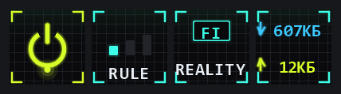

# Prizrak-Box VPN для OpenDeck

Плагин для [OpenDeck](https://github.com/nekename/OpenDeck), который добавляет
управление VPN [Prizrak-Box](https://prizrak-box.ru) прямо на стримдек.

Четыре кнопки: включение VPN, режим маршрутизации, выбор сервера и скорость
трафика. Всё обновляется само — состояние читается из приложения.



## Что умеет

| Кнопка | Действие |
|---|---|
| **VPN** | Включить или выключить TUN. Зелёное кольцо — работает, красное с крестом — выключен |
| **Режим** | Переключить `rule` → `global` → `direct`. Индикаторы показывают текущий |
| **Сервер** | Переключить следующий сервер в группе PROXY. Имя берётся из приложения |
| **Скорость** | Загрузка и отдача в реальном времени |

Состояние опрашивается каждые 3 секунды, поэтому кнопки не расходятся
с реальностью — даже если VPN включили из самого приложения.

## Требования

- **OpenDeck** 2.x
- **Node.js 20 или новее** — OpenDeck запускает плагины на Node
- **Prizrak-Box** — запущенный хотя бы раз (нужен для чтения настроек API)
- Стримдек на чипе AKP153 / Mirabox HSV293S и совместимые

## Установка

1. Скачайте репозиторий (Code → Download ZIP) или склонируйте:

   ```bash
   git clone https://github.com/VovaBurry/opendeck-prizrak-vpn.git
   ```

2. Скопируйте папку `com.enerby.prizrakvpn.sdPlugin` в каталог плагинов
   OpenDeck:

   | ОС | Путь |
   |---|---|
   | Windows | `%APPDATA%\opendeck\plugins\` |
   | macOS | `~/Library/Application Support/opendeck/plugins/` |
   | Linux | `~/.config/opendeck/plugins/` |

   Должно получиться так:

   ```
   %APPDATA%\opendeck\plugins\com.enerby.prizrakvpn.sdPlugin\manifest.json
   ```

3. **Перезапустите OpenDeck.** Плагины читаются только при старте.

4. Откройте редактор профиля и перетащите действия из категории
   **Prizrak-Box VPN** на нужные клавиши.

## Настройка

Ничего настраивать не нужно. Плагин сам находит порт и секрет API
ядра mihomo, читая их из Local Storage Prizrak-Box.

Если кнопки показывают «нет связи»:

- убедитесь, что Prizrak-Box запущен;
- проверьте лог: `%APPDATA%\opendeck\plugins\com.enerby.prizrakvpn.sdPlugin\logs\prizrakvpn.log`.

Если приложение запустили уже после OpenDeck, плагин подключится сам
при следующем опросе — перезапуск не нужен.

## Как это работает

Плагин общается с ядром mihomo по локальному API:

| Запрос | Назначение |
|---|---|
| `GET /configs` | состояние VPN и режим |
| `PATCH /configs` | включение TUN, смена режима |
| `GET /proxies` | список серверов и текущий выбор |
| `PUT /proxies/{группа}` | переключение сервера |
| `GET /connections` | счётчики трафика |

Скорость считается по приращению счётчиков за окно в 2 секунды —
само ядро скорость не отдаёт.

## Поддерживаемые устройства

Плагин рисует картинки в размере **95 × 95** — это формат, который
ожидает плагин устройств AKP153. На устройстве с другими размерами
изображение может масштабироваться.

Иконки генерируются кодом на лету, поэтому ничего не устаревает
при смене серверов или режимов.

## Не работает?

**Кнопки чёрные / пустые.** Проверьте, что установлен Node 20+:

```bash
node --version
```

**«Нет связи» на всех кнопках.** Prizrak-Box не запущен, либо API
на нестандартном порту. Откройте лог плагина — там будет причина.

**Изменился состав серверов, а кнопка показывает старое.** Такого быть
не должно: имя читается из API. Если всё же случилось — пришлите лог.

## Лицензия

MIT — см. [LICENSE](LICENSE).
